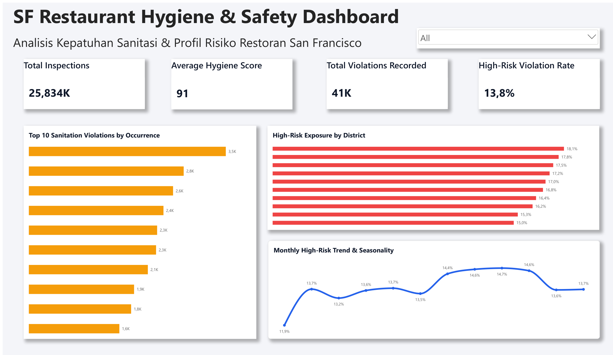
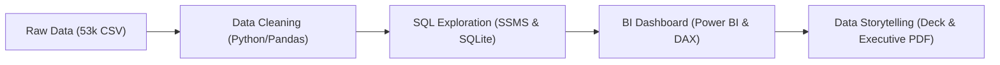

# San Francisco Restaurant Hygiene & Safety Analytics
### End-to-End Data Analytics Portfolio | Public Health & Regulatory Intelligence

[](notebooks/)
[](sql/)
[](Dashboard.pbix)
[]()

> **Projek End-to-End Data Analytics:** Mengolah dan menganalisis **53.973 baris** catatan inspeksi restoran San Francisco Department of Public Health (SFDPH) periode 2014–2016 menjadi **dashboard analitik interaktif**, **eksplorasi SQL mendalam**, serta **rekomendasi berbasis bukti** untuk memprioritaskan mitigasi risiko keamanan pangan publik.

---

## Dashboard Preview

[](San%20Francisco%20Restaurant%20Hygiene%20&%20Safety%20Analytics.pdf)
*Snapshot resmi dari dashboard Power BI (klik gambar untuk membuka file PDF laporan lengkap: [San Francisco Restaurant Hygiene & Safety Analytics.pdf](San%20Francisco%20Restaurant%20Hygiene%20&%20Safety%20Analytics.pdf)).*

---

## Ringkasan Eksekutif dan Temuan Kunci

Analisis ini menjawab pertanyaan strategis bagi regulator dan pengambil kebijakan kesehatan publik:

| Metrik / Analisis | Temuan Kunci (*Key Insight*) | Dampak bagi Keputusan |
| :--- | :--- | :--- |
| **Kesehatan Umum** | **Rata-rata skor 91,3** (Median 93). Sebanyak **68,0%** restoran berada di kategori *Good/Excellent* (skor 90–100). | Mayoritas industri kuliner patuh, pengawasan reguler berjalan stabil. |
| **Risiko Kritis** | **1 dari 6 inspeksi (16,0%)** menemukan setidaknya 1 pelanggaran berisiko tinggi (*High Risk*). | Fokus inspektur dialihkan ke deteksi dini bahaya kritis langsung. |
| **Prinsip Pareto** | **10 jenis pelanggaran teratas** menyumbang **57,7% (~58%)** dari total 40.623 pelanggaran. Pelanggaran terbanyak: suhu makanan dan sanitasi permukaan. | Standardisasi checklist edukasi ringkas untuk 3 pelanggaran paling fatal. |
| **Kluster Wilayah** | Kode Pos **94104 (Financial District)** memimpin proporsi risiko tinggi sebesar **22,9%**, disusul 94122 (Sunset) dan 94116. | Penjadwalan inspeksi berbasis zonasi risiko tinggi (*risk-based scheduling*). |
| **Pola Musiman Hama** | Temuan hama (*vermin infestation*) melonjak **+94,6%** di musim panas (puncak Juni 353 kasus vs rata-rata Des–Jan 176 kasus). | Program audit dan sertifikasi pengendalian hama preventif di bulan Maret–April. |
| **Efektivitas Tindakan** | Restoran zona *Poor* (<70) yang diinspeksi ulang mengalami lonjakan skor: median naik dari **66 ke 81** (**84,2% berhasil lepas dari zona berbahaya**). | Bukti valid bahwa intervensi langsung dinas kesehatan berdampak nyata. |

---

## Alur Kerja Analisis (*Pipeline*)

Projek ini dibangun secara terstruktur mengikuti siklus hidup data analis profesional:



### 1. Data Cleaning & Wrangling (Python / Pandas)
- **Penanganan Anomali:** Membersihkan format tanggal, imputasi nilai hilang, standardisasi penamaan entitas bisnis dan alamat.
- **Normalisasi Granularitas:** Memisahkan data mentah menjadi 2 tabel analitik yang efisien:
  - `sf_inspections_summary.csv`: **25.834 sesi inspeksi** unik dengan skor, status risiko, dan metadata wilayah.
  - `sf_restaurant_inspections_cleaned.csv`: **40.623 detail temuan pelanggaran** beserta kode dan deskripsinya.
- Tautan file: [notebooks/01_data_cleaning.ipynb](notebooks/01_data_cleaning.ipynb) dan [scripts/clean_data.py](scripts/clean_data.py)

### 2. Deep Dive & Exploratory Data Analysis (SQL)
- Query analitik terstruktur menggunakan Common Table Expressions (CTEs), Window Functions (`ROW_NUMBER()`, `LAG()`, `OVER`), agregasi multi-dimensi, dan analisis kohor inspeksi ulang.
- Tersedia dalam 2 dialek: **SQLite** (lokal portabel) dan **T-SQL** (siap dieksekusi di SQL Server Management Studio / SSMS).
- Tautan file: [sql/exploratory_data_analysis.sql](sql/exploratory_data_analysis.sql) dan [sql/mssql_eda_queries.sql](sql/mssql_eda_queries.sql)

### 3. Business Intelligence & Modeling (Power BI)
- **Data Modeling & DAX:** Perancangan kolom kalkulasi, klasifikasi lingkungan (*neighborhood classification*), serta filter dinamis *Top N*.
- **Desain Visual:** Layout eksekutif 16:9 dengan kontras tinggi yang ramah aksesibilitas (*Navy Slate, Warning Coral, Emerald Green*), dilengkapi sinkronisasi slicer antar visual.
- Tautan file: [Dashboard.pbix](Dashboard.pbix) dan [San Francisco Restaurant Hygiene & Safety Analytics.pdf](San%20Francisco%20Restaurant%20Hygiene%20&%20Safety%20Analytics.pdf)

### 4. Data Storytelling & Presentation (PowerPoint & PDF)
- Paparan 15 slide eksekutif yang disusun menggunakan kerangka **SCQA** (*Situation -> Complication -> Resolution*).
- Dilengkapi **Speaker Notes** per slide berbahasa Indonesia untuk presentasi langsung kepada pimpinan dinas atau dewan direksi.
- Tautan file: [Storytelling_SF_Restaurant_Hygiene_Gilang_Anugrah.pptx](reports/Storytelling_SF_Restaurant_Hygiene_Gilang_Anugrah.pptx) dan [Storytelling_SF_Restaurant_Hygiene_Gilang_Anugrah.pdf](reports/Storytelling_SF_Restaurant_Hygiene_Gilang_Anugrah.pdf)

---

## Rekomendasi Strategis untuk Stakeholder (SFDPH)

1. **Inspeksi Berbasis Risiko Wilayah (*Targeted Zoning*):** Alokasikan 40% jam kerja inspektur ke 5 kode pos dengan insiden High Risk tertinggi (`94104`, `94122`, `94116`, `94133`, `94108`).
2. **Kampanye Pencegahan Hama Pra-Musim Panas:** Wajibkan audit kepatuhan pengendalian hama mandiri setiap bulan April sebelum lonjakan musiman bulan Juni.
3. **Standar Waktu Re-Inspeksi Maksimal 14 Hari:** Percepat jadwal verifikasi ulang untuk restoran dengan skor <70 guna meminimalkan risiko kontaminasi berkelanjutan.
4. **Portal Transparansi Publik:** Tampilkan skor inspeksi melalui QR code fisik pada pintu masuk restoran guna memberdayakan konsumen dan mendorong kepatuhan pelaku usaha.

---

## Struktur Direktori Repositori

```text
├── dashboard/                  # Template visual dan file aset Power BI
│   ├── professional_theme.json # Palet warna tema Power BI
│   └── dashboard_powerbi.png   # Snapshot dashboard Power BI resolusi tinggi
├── data/
│   ├── raw/                    # Dataset mentah dan file spasial GIS SF
│   └── processed/              # Dataset bersih (.csv) dan basis data SQLite (.db)
├── notebooks/
│   ├── 01_data_cleaning.ipynb  # Pembersihan, validasi, dan transformasi data
│   └── 02_eda_and_insights.ipynb # Eksplorasi statistik visual dan korelasi
├── reports/
│   ├── figures/                # 8 Visualisasi chart analitis resolusi tinggi
│   ├── Storytelling_...pptx    # Slide presentasi eksekutif (15 slide + speaker notes)
│   └── Storytelling_...pdf     # Versi PDF siap cetak / kirim
├── scripts/                    # Script otomatisasi Python (pembersihan data dan generator slide)
├── sql/
│   ├── exploratory_data_analysis.sql # Query EDA standar SQLite
│   └── mssql_eda_queries.sql         # Query EDA T-SQL untuk SSMS
├── Dashboard.pbix              # File kerja Power BI Desktop
├── San Francisco ...pdf        # Ekspor laporan visual Power BI (PDF)
└── README.md                   # Ringkasan utama projek
```

---

## Panduan Menjalankan Analisis

### 1. Prasyarat Lingkungan
```bash
git clone https://github.com/Gilang999-web/sf-restaurant-hygiene-analytics.git
cd sf-restaurant-hygiene-analytics

pip install pandas numpy matplotlib seaborn python-pptx
```

### 2. Pembersihan Data dan EDA
```bash
python scripts/clean_data.py
```

### 3. Eksekusi Query SQL
- **SQLite:** Buka `data/processed/sf_inspections.db` menggunakan DBeaver atau jalankan script `scripts/run_sql_eda.py`.
- **SQL Server (SSMS):** Buka file `sql/mssql_eda_queries.sql`, import `data/processed/sf_inspections_summary.csv` menggunakan SQL Server Import Wizard, lalu jalankan query.

### 4. Membuka Dashboard Power BI
- Buka file [Dashboard.pbix](Dashboard.pbix) menggunakan aplikasi **Power BI Desktop**.
- Arahkan sumber data ke `data/processed/sf_inspections_summary.csv` apabila diminta memperbarui path lokal.

---

## Profil Analis

**Gilang Anugrah**  
Data Analyst | Business Intelligence & Analytics Specialist  
- Keahlian: Python (Pandas, Data Cleaning), SQL (T-SQL, Window Functions), Power BI (DAX, Data Modeling), Data Storytelling & Presentation.

---
*Projek ini disusun sebagai portofolio profesional analitik data dengan standar industri end-to-end.*
