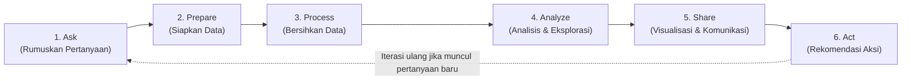
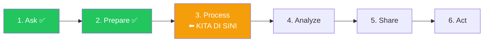

# 🗺️ Panduan Alur Kerja Data Analyst (Best Practice)

Dokumen ini menjelaskan langkah-langkah standar yang dilakukan seorang Data Analyst profesional dari awal hingga akhir proyek, beserta penerapannya pada dataset **SF Restaurant Inspection Scores**.

---

## Kerangka Kerja: Data Analytics Lifecycle

Di industri, alur kerja Data Analyst mengikuti siklus yang dikenal sebagai **CRISP-DM** (*Cross-Industry Standard Process for Data Mining*) atau variasinya. Intinya ada **6 tahap besar** yang saling terhubung:

> [!IMPORTANT]
> Kunci utama yang membedakan Data Analyst **pemula** vs **profesional**: 
> - Pemula langsung loncat ke tahap 3-4 (bersihkan data, buat grafik).
> - Profesional **selalu mulai dari tahap 1** (memahami masalah bisnis dulu) dan **selalu berakhir di tahap 6** (memberikan rekomendasi aksi yang konkret).

---

## Tahap 1: ASK — Rumuskan Pertanyaan Bisnis

### Apa yang dilakukan?
Sebelum menyentuh data sama sekali, seorang Data Analyst harus memahami **konteks bisnis** dan merumuskan pertanyaan yang jelas. Tanpa ini, analisis Anda tidak punya arah.

### Framework yang digunakan:
- **Siapa stakeholder-nya?** (Untuk siapa analisis ini dibuat?)
- **Apa masalah/tujuan bisnisnya?** (Bukan "saya mau buat grafik", tapi "masalah apa yang ingin dipecahkan?")
- **Apa metrik keberhasilannya?** (Bagaimana kita tahu analisis ini berhasil?)

### Penerapan pada proyek ini:

| Komponen | Isi |
| :--- | :--- |
| **Stakeholder** | Kepala Dinas Kesehatan San Francisco (SFDPH) |
| **Masalah Bisnis** | Anggaran dan jumlah inspektur lapangan terbatas. Perlu strategi agar inspeksi lebih tepat sasaran: memprioritaskan restoran dan wilayah yang paling berisiko tinggi |
| **Pertanyaan Bisnis Utama** | 1. Wilayah (kode pos) mana yang memiliki konsentrasi pelanggaran High Risk tertinggi? 2. Jenis pelanggaran apa yang paling sering muncul dan paling berbahaya? 3. Apakah restoran yang pernah mendapat skor rendah menunjukkan perbaikan setelah re-inspection? 4. Kapan waktu (bulan/kuartal) terbaik untuk mengintensifkan inspeksi? |
| **Metrik Keberhasilan** | Rekomendasi alokasi inspektur berdasarkan data, bukan asumsi |

### Deliverable tahap ini:
📄 Dokumen singkat berisi daftar pertanyaan bisnis (sudah kita definisikan di atas).

---

## Tahap 2: PREPARE — Siapkan & Pahami Data

### Apa yang dilakukan?
Mengumpulkan data yang dibutuhkan, memahami struktur dan keterbatasannya, serta menilai apakah data tersebut **layak dan cukup** untuk menjawab pertanyaan bisnis di Tahap 1.

### Checklist yang harus dijawab:
- [x] **Dari mana sumber datanya?** → Dataset resmi SFDPH via portal DataSF / Kaggle.
- [x] **Apakah datanya kredibel (ROCCC)?**
  - **R**eliable (Andal): Ya, sumber resmi pemerintah.
  - **O**riginal: Ya, data primer langsung dari sistem inspeksi.
  - **C**omprehensive (Lengkap): Mencakup 6.078 restoran, 25.834 inspeksi, periode 2014–2015.
  - **C**urrent (Terkini): Data historis 2014–2015 (cukup untuk analisis tren, tapi perlu dicatat sebagai limitasi).
  - **C**ited (Tersitasi): Sumber jelas dan bisa diverifikasi.
- [x] **Apa granularitas datanya?** → Per pelanggaran (1 baris = 1 violation).
- [x] **Apa saja kolomnya dan tipe datanya?** → 17 kolom (sudah didokumentasikan di `tentang_dataset.md`).
- [x] **Seberapa banyak data yang hilang (*missing values*)?** → Ada missing values signifikan di beberapa kolom (koordinat, skor, violation).

### Deliverable tahap ini:
📄 Dokumen `tentang_dataset.md` (sudah dibuat sebelumnya — Data Dictionary, granularitas, dan konteks domain).

---

## Tahap 3: PROCESS — Bersihkan & Transformasi Data

### Apa yang dilakukan?
Membersihkan data mentah (*raw data*) agar siap dianalisis. Tahap ini biasanya **menghabiskan 60–80% waktu** seorang Data Analyst.

### Langkah-langkah standar:

| No | Langkah | Penerapan pada Dataset Ini |
| :--- | :--- | :--- |
| 1 | **Cek & perbaiki tipe data** | Konversi `inspection_date` dari string ke format datetime |
| 2 | **Tangani missing values** | Pahami konteks: `violation_id` = NaN artinya inspeksi bersih (BUKAN data rusak). `inspection_score` = NaN karena tipe inspeksi non-rutin (memang tidak diberi skor) |
| 3 | **Cek duplikasi** | Pastikan tidak ada baris data yang benar-benar identik secara tidak wajar |
| 4 | **Validasi konsistensi** | Cek apakah `business_city` selalu "San Francisco", apakah skor selalu dalam rentang 0–100 |
| 5 | **Feature engineering** (buat kolom baru) | Ekstrak `year`, `month`, `day_of_week` dari `inspection_date`. Buat kolom `score_category` (Excellent/Adequate/Poor) |
| 6 | **Buat tabel analisis terpisah** | Pisahkan tabel level inspeksi (1 baris = 1 inspeksi) dari tabel level pelanggaran, karena granularitas yang berbeda butuh analisis yang berbeda pula |

### Deliverable tahap ini:
📓 Notebook `01_data_cleaning.ipynb` + file CSV bersih di folder `data/processed/`.

> [!WARNING]
> **Aturan Emas Data Cleaning:**
> - Data mentah di folder `data/raw/` **TIDAK BOLEH diubah sama sekali**. Selalu simpan hasil cleaning ke folder terpisah (`data/processed/`).
> - Setiap keputusan cleaning harus **didokumentasikan** alasannya (misalnya: "Saya tidak menghapus baris dengan `inspection_score` = NaN karena itu adalah inspeksi non-rutin yang memang tidak memiliki skor").

---

## Tahap 4: ANALYZE — Eksplorasi & Temukan Pola

### Apa yang dilakukan?
Melakukan **Exploratory Data Analysis (EDA)** untuk menemukan pola, tren, anomali, dan hubungan antar variabel yang menjawab pertanyaan bisnis di Tahap 1.

### Jenis analisis yang dilakukan:

#### A. Analisis Deskriptif (*Descriptive*)
> "Apa yang terjadi?"
- Berapa rata-rata skor inspeksi keseluruhan? (Jawaban: ~86 dari 100)
- Berapa proporsi pelanggaran Low vs Moderate vs High Risk?
- Top 10 jenis pelanggaran paling sering terjadi?

#### B. Analisis Diagnostik (*Diagnostic*)
> "Mengapa itu terjadi?"
- Mengapa wilayah kode pos tertentu punya rata-rata skor lebih rendah? (Apakah karena jenis usahanya berbeda? Lebih banyak restoran kecil/street food?)
- Mengapa beberapa restoran berulang kali mendapat pelanggaran High Risk?

#### C. Analisis Tren (*Trend*)
> "Bagaimana perubahannya dari waktu ke waktu?"
- Apakah rata-rata skor inspeksi membaik atau memburuk dari 2014 ke 2015?
- Apakah ada bulan-bulan tertentu di mana pelanggaran hama (*vermin*) melonjak? (Misal: musim panas?)

#### D. Analisis Perbandingan (*Comparative*)
> "Apa bedanya antara kelompok A dan kelompok B?"
- Perbandingan skor antara restoran yang pernah di-reinspect vs yang tidak.
- Perbandingan profil risiko antar distrik/kode pos.

### Deliverable tahap ini:
📓 Notebook `02_eda_and_insights.ipynb` dengan visualisasi dan narasi temuan.

---

## Tahap 5: SHARE — Visualisasi & Komunikasikan Temuan

### Apa yang dilakukan?
Mengemas temuan analisis menjadi **visualisasi yang mudah dipahami** oleh stakeholder non-teknis. Ingat: stakeholder Anda (Kepala Dinas Kesehatan) tidak membaca kode Python — mereka membaca grafik dan ringkasan eksekutif.

### Prinsip Visualisasi Data yang Baik:
1. **Setiap grafik harus menjawab 1 pertanyaan spesifik** (beri judul yang berupa pernyataan/insight, bukan sekadar label).
   - ❌ Judul buruk: "Bar Chart Skor Inspeksi"
   - ✅ Judul baik: "76% Restoran SF Memiliki Skor Sanitasi di Atas 80 (Kategori Aman)"
2. **Pilih jenis chart yang tepat:**
   - Perbandingan kategori → Bar Chart
   - Tren waktu → Line Chart
   - Distribusi → Histogram
   - Proporsi → Pie/Donut Chart (hanya untuk ≤5 kategori)
   - Korelasi → Scatter Plot
   - Geospasial → Heatmap / Peta
3. **Warna bermakna, bukan dekoratif:** Gunakan merah untuk High Risk, kuning untuk Moderate, hijau untuk Low.

### Format penyampaian (pilih salah satu atau kombinasi):
- 📊 **Dashboard Interaktif:** Tableau Public, Power BI, atau Streamlit.
- 📑 **Slide Presentasi:** Google Slides / PowerPoint (5–10 slide).
- 📄 **README.md di GitHub:** Executive summary + screenshot visualisasi.

### Deliverable tahap ini:
Dashboard atau laporan visual dengan 4–6 visualisasi kunci.

---

## Tahap 6: ACT — Berikan Rekomendasi Aksi

### Apa yang dilakukan?
Tahap ini yang **paling sering dilewatkan** oleh Data Analyst pemula, padahal ini adalah tahap yang **paling dinilai oleh recruiter dan hiring manager**.

Anda harus menjawab: **"Lalu stakeholder harus melakukan apa berdasarkan temuan ini?"**

### Contoh format rekomendasi profesional:

> **Temuan:** 45% pelanggaran High Risk terkonsentrasi di 5 kode pos (dari total 28 kode pos).
>
> **Rekomendasi:** Alokasikan 60% kapasitas inspektur ke 5 wilayah tersebut pada kuartal berikutnya. Estimasi dampak: peningkatan deteksi dini pelanggaran kritis sebesar 30% dengan sumber daya yang sama.

> **Temuan:** Restoran yang menjalani Reinspection dalam 14 hari menunjukkan peningkatan skor rata-rata +12 poin pada inspeksi berikutnya.
>
> **Rekomendasi:** Perketat batas waktu reinspection dari 30 hari menjadi 14 hari untuk seluruh kasus High Risk, karena data menunjukkan bahwa semakin cepat ditindaklanjuti, semakin besar kemungkinan restoran memperbaiki pelanggaran.

### Deliverable tahap ini:
📄 Bagian "Actionable Recommendations" di laporan akhir / README.md / slide presentasi.

---

## Ringkasan: Peta Jalan Proyek Portofolio Anda

| Tahap | Aktivitas | Output File |
| :--- | :--- | :--- |
| 1. Ask | Definisikan pertanyaan bisnis & stakeholder | `README.md` (bagian Business Problem) |
| 2. Prepare | Dokumentasi dataset & data dictionary | `tentang_dataset.md` ✅ (sudah selesai) |
| 3. Process | Data cleaning & transformasi | `notebooks/01_data_cleaning.ipynb` + `data/processed/*.csv` |
| 4. Analyze | EDA, statistik, temukan pola & insight | `notebooks/02_eda_and_insights.ipynb` |
| 5. Share | Dashboard / visualisasi / presentasi | `dashboard/` atau screenshot di `reports/figures/` |
| 6. Act | Tulis rekomendasi aksi konkret | `README.md` (bagian Recommendations) |

> [!TIP]
> **Tips untuk portofolio yang menonjol:**
> - Recruiter rata-rata hanya melihat portofolio GitHub Anda selama **30 detik – 2 menit**. Pastikan `README.md` langsung menampilkan: (1) Masalah bisnis, (2) 3 insight utama dengan grafik, (3) Rekomendasi aksi. Baru setelah itu detail teknis.
> - Gunakan narasi orang pertama: *"Saya menganalisis 25.834 catatan inspeksi untuk mengidentifikasi..."* — ini menunjukkan ownership dan kemampuan komunikasi.

---

## Posisi Kita Sekarang

Tahap 1 (Ask) dan Tahap 2 (Prepare) sudah selesai. Langkah selanjutnya adalah masuk ke **Tahap 3: Process (Data Cleaning)**.

