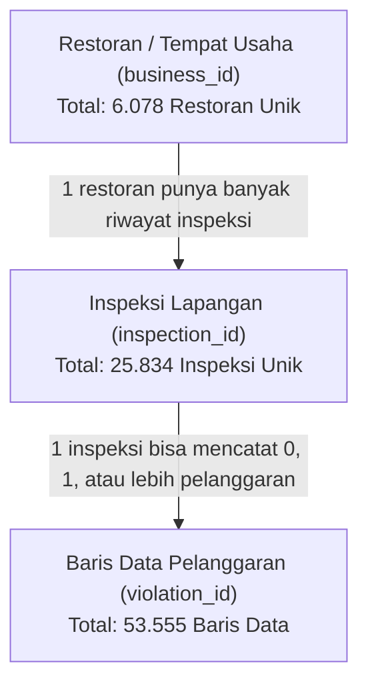

# 📋 Panduan Komprehensif: SF Restaurant Inspection Scores (LIVES Standard)

Dokumen ini disusun untuk memberikan pemahaman mendalam (*domain knowledge*) mengenai dataset inspeksi restoran San Francisco. Memahami latar belakang, struktur data, dan logika operasional dataset ini adalah fondasi penting sebelum melakukan analisis data profesional.

---

## 1. Latar Belakang & Definisi Dataset

### Apa Itu Dataset Ini?
Dataset ini berisi catatan resmi inspeksi kesehatan dan sanitasi restoran serta tempat usaha kuliner yang dilakukan oleh **San Francisco Department of Public Health (SFDPH)** (Dinas Kesehatan Masyarakat Kota San Francisco, California, Amerika Serikat).

Data ini dipublikasikan secara terbuka melalui portal data resmi kota San Francisco (**DataSF**) dan menggunakan standar **LIVES**.

### Apa Itu Standar LIVES?
**LIVES** singkatan dari *Local Inspector Value-Entry Specification*. Standar ini adalah format data terbuka (*open standard*) yang awalnya dirancang melalui kolaborasi antara **Pemerintah Kota San Francisco** dan platform **Yelp**. 

Tujuannya adalah:
1. Menyeragamkan cara pelaporan inspeksi sanitasi restoran antar daerah.
2. Memungkinkan platform publik (seperti Yelp, portal pemerintah, atau aplikasi peta) untuk menampilkan skor kebersihan restoran secara transparan kepada masyarakat.

### Fungsi Utama Data Ini Dikumpulkan:
1. **Perlindungan Kesehatan Masyarakat (*Public Health*):** Mencegah wabah penyakit bawaan makanan (*foodborne illnesses*, misalnya keracunan *Salmonella* atau *E. coli*).
2. **Pengawasan & Kepatuhan Bisnis (*Regulatory Compliance*):** Memastikan restoran dan pedagang makanan memenuhi standar *California Health and Safety Code*.
3. **Transparansi Konsumen:** Membantu pelanggan mengambil keputusan yang tepat saat memilih tempat makan.
4. **Optimasi Operasional Lapangan:** Membantu dinas kesehatan menjadwalkan ulang inspeksi (*re-inspection*) pada restoran yang memiliki catatan pelanggaran berulang atau berisiko tinggi.

---

## 2. Struktur Granularitas Data (*Data Grain & Hierarchy*)

Salah satu pembeda utama antara data analyst pemula dan profesional adalah pemahaman terhadap **tingkat granularitas data (*data grain*)**:



> [!IMPORTANT]
> **Poin Kritis dalam Analisis:**
> - **1 Baris Data $\neq$ 1 Restoran** dan **1 Baris Data $\neq$ 1 Inspeksi**.
> - **1 Baris Data = 1 Pelanggaran (*violation*)** yang ditemukan pada satu sesi inspeksi tertentu.
> - Jika dalam satu inspeksi ditemukan **3 jenis pelanggaran**, maka akan muncul **3 baris data** dengan `inspection_id` dan `inspection_score` yang sama.
> - Jika restoran bersih sempurna (**tanpa pelanggaran sama sekali**), data tetap mencatat 1 baris inspeksi dengan `inspection_score` = 100, tetapi kolom `violation_id`, `violation_description`, dan `risk_category` bernilai `NaN` (bukan data rusak/hilang, melainkan bukti bahwa tidak ada pelanggaran!).

---

## 3. Kamus Data Lengkap (*Data Dictionary*)

Dataset ini memiliki **17 kolom** yang dapat dikelompokkan ke dalam 4 dimensi:

### A. Dimensi Identitas Usaha (*Business Entity*)
| Nama Kolom | Tipe Data | Deskripsi & Makna Bisnis | Contoh Nilai |
| :--- | :--- | :--- | :--- |
| `business_id` | Integer | ID unik untuk setiap entitas usaha kuliner di San Francisco. Digunakan sebagai *Primary Key* restoran. | `10`, `24`, `1604` |
| `business_name` | String / Object | Nama resmi atau nama komersial tempat usaha (nama restoran, kafe, bakery, kantin). | `"Tiramisu Kitchen"`, `"Starbucks Coffee"` |
| `business_address` | String / Object | Alamat jalan lokasi fisik tempat usaha. | `"333 Geary St"`, `"555 California St"` |
| `business_city` | String / Object | Nama kota (seluruhnya di area San Francisco). | `"San Francisco"` |
| `business_state` | String / Object | Singkatan negara bagian (California). | `"CA"` |
| `business_postal_code` | String / Object | Kode pos area. Sangat berguna untuk segmentasi wilayah dan analisis geografis berbasis distrik. | `"94102"`, `"94110"` |
| `business_phone_number` | Float / String | Nomor kontak telepon tempat usaha (banyak yang null/tidak tercatat). | `14155529000` |

### B. Dimensi Lokasi Geografis (*Geographic & Spatial*)
| Nama Kolom | Tipe Data | Deskripsi & Makna Bisnis | Contoh Nilai |
| :--- | :--- | :--- | :--- |
| `business_latitude` | Float | Titik koordinat garis lintang (*latitude*). Berguna untuk visualisasi peta sebaran (*geospatial mapping*). | `37.7865`, `37.7612` |
| `business_longitude` | Float | Titik koordinat garis bujur (*longitude*). Dipasangkan dengan latitude untuk membuat peta interaktif. | `-122.408`, `-122.419` |
| `business_location` | String / Object | Representasi teks gabungan koordinat WKT (*Well-Known Text*) atau titik spasial. | `POINT (-122.408 37.7865)` |

### C. Dimensi Sesi Inspeksi (*Inspection Event*)
| Nama Kolom | Tipe Data | Deskripsi & Makna Bisnis | Contoh Nilai |
| :--- | :--- | :--- | :--- |
| `inspection_id` | String / Object | ID unik untuk satu sesi kunjungan inspeksi tertentu. Terdiri dari gabungan `business_id` dan tanggal inspeksi. | `"10_20140114"`, `"24_20140609"` |
| `inspection_date` | String / Object (Datetime) | Waktu kapan inspeksi tersebut dilakukan oleh petugas. Perlu dikonversi ke format datetime untuk analisis tren bulanan/tahunan. | `"01/14/2014 12:00:00 AM"` |
| `inspection_score` | Float | Skor kebersihan numerik dari skala **0 hingga 100**.<br/>- Restoran mulai dengan skor awal 100.<br/>- Poin dikurangi berdasarkan bobot setiap pelanggaran yang ditemukan.<br/>- **Catatan Penting:** Skor ini hanya diberikan pada inspeksi rutin (*Routine - Unscheduled*). Tipe inspeksi lanjutan/keluhan umumnya tidak memiliki skor numerik (`NaN`). | `100.0`, `92.0`, `76.0`, `NaN` |
| `inspection_type` | String / Object | Jenis/alasan inspeksi dilakukan. Kategori terbanyak:<br/>1. `Routine - Unscheduled`: Kunjungan mendadak berkala.<br/>2. `Reinspection/Followup`: Kunjungan ulang untuk memverifikasi perbaikan.<br/>3. `Complaint`: Inspeksi berdasarkan laporan keluhan warga/konsumen.<br/>4. `New Ownership / Construction`: Inspeksi perizinan awal usaha baru. | `"Routine - Unscheduled"`, `"Reinspection/Followup"`, `"Complaint"` |

### D. Dimensi Temuan Pelanggaran & Risiko (*Violation & Risk Assessment*)
| Nama Kolom | Tipe Data | Deskripsi & Makna Bisnis | Contoh Nilai |
| :--- | :--- | :--- | :--- |
| `violation_id` | String / Object | ID unik untuk kode pelanggaran yang ditemukan. Jika inspeksi bersih, kolom ini `NaN`. | `"10_20140114_103119"` |
| `violation_description` | String / Object | Penjelasan spesifik mengenai aturan sanitasi apa yang dilanggar oleh restoran saat inspeksi. | `"Inadequate and inaccessible handwashing facilities"`, `"High risk vermin infestation"` |
| `risk_category` | String / Object | Klasifikasi tingkat keparahan risiko kesehatan dari pelanggaran tersebut:<br/>1. **Low Risk:** Pelanggaran ringan (misal: lantai kotor, peralatan tidak tersusun rapi).<br/>2. **Moderate Risk:** Pelanggaran sedang (misal: air panas kurang optimal, label makanan kurang jelas).<br/>3. **High Risk:** Pelanggaran berat yang langsung mengancam keselamatan konsumen (misal: hama/tikus/kecoa aktif, kontaminasi limbah, suhu penyimpanan daging tidak aman). | `"Low Risk"`, `"Moderate Risk"`, `"High Risk"`, `NaN` |

---

## 4. Sistem Penilaian Skor Inspeksi (0 - 100)

Standar SFDPH menggunakan sistem penalti pengurangan nilai:
- Setiap restoran memulai sesi inspeksi dengan **100 poin**.
- Pelanggaran ringan (*Low Risk*) mengurangi sedikit poin (~1-3 poin).
- Pelanggaran sedang (*Moderate Risk*) mengurangi poin sedang (~3-5 poin).
- Pelanggaran berat (*High Risk*) mengurangi poin besar (~7-10+ poin).

Interpretasi Skor di Dunia Nyata:
- **90 – 100:** Kategori **Excellent / Good** (Standar sanitasi sangat tinggi).
- **80 – 89:** Kategori **Adequate** (Memenuhi syarat dasar, ada beberapa catatan perbaikan ringan/sedang).
- **70 – 79:** Kategori **Needs Improvement** (Kurang memuaskan, berisiko mendapatkan inspeksi ulang dalam waktu dekat).
- **< 70:** Kategori **Poor** (Banyak pelanggaran berat, berpotensi dikenai surat peringatan keras, denda, atau pencabutan izin operasi sementara / *permit suspension*).

---

## 5. Studi Kasus Nyata: Skenario Operasional Sehari-hari

Untuk memberikan gambaran konkret bagaimana data ini lahir dan digunakan di dunia nyata, bayangkan skenario operasional berikut:

### Skenario Operasional: "Restoran Luigi's Pasta di San Francisco"

```
Hari 1: Kunjungan Rutin Mendadak (Routine - Unscheduled)
--------------------------------------------------------
Seorang petugas Environmental Health Inspector dari SFDPH bernama Sarah datang tanpa 
pemberitahuan sebelumnya ke Restoran Luigi's Pasta (business_id: 10).

Sarah memeriksa 3 area utama:
1. Dapur & Penyimpanan Makanan:
   - Sarah mengukur suhu kulkas daging menggunakan termometer: ditemukan 15°C (seharusnya < 4°C).
   - Temuan: "High risk food holding temperature" -> [HIGH RISK] (Poin berkurang 10).
2. Sanitasi & Wastafel:
   - Wastafel cuci tangan staf tidak memiliki sabun dan terhalang tumpukan panci.
   - Temuan: "Inadequate handwashing facilities" -> [MODERATE RISK] (Poin berkurang 4).
3. Lantai & Kebersihan Umum:
   - Lantai area belakang dekat tempat sampah kotor dan berdebu.
   - Temuan: "Unclean floors" -> [LOW RISK] (Poin berkurang 2).

Hasil Inspeksi Hari 1:
- Skor Akhir: 100 - (10 + 4 + 2) = 84 (Kategori: Adequate).
- Data Masuk ke Sistem LIVES:
  Tercatat 3 baris data untuk inspection_id "10_20140114" dengan skor 84.
- Keputusan Petugas: Karena ada pelanggaran [HIGH RISK] (suhu kulkas berbahaya), Sarah 
  memberi batas waktu 14 hari dan menjadwalkan kunjungan ulang (Reinspection).
```

```
Hari 14: Kunjungan Verifikasi Ulang (Reinspection/Followup)
----------------------------------------------------------
Sarah kembali ke Restoran Luigi's Pasta:
- Sarah mengecek kulkas: pemilik sudah memperbaiki kompresor pendingin (suhu sekarang 2°C, aman).
- Wastafel sudah bersih, sabun terpasang, panci dipindahkan.
- Temuan: Semua pelanggaran High & Moderate telah diselesaikan.
- Data Masuk ke Sistem LIVES:
  Tercatat 1 baris dengan inspection_type = "Reinspection/Followup", violation_id = NaN, 
  dan inspection_score = NaN (kunjungan followup tidak menghasilkan skor baru, hanya verifikasi).
```

```
Dampak ke Konsumen (Yelp & Publik):
----------------------------------
Melalui integrasi API LIVES, data skor 84 langsung terupdate di halaman profil Yelp restoran.
Pelanggan yang ingin makan di Luigi's Pasta bisa melihat bahwa restoran tersebut pernah 
memiliki catatan sanitasi suhu makanan, namun telah menyelesaikan perbaikan.
```

---

## 6. Sudut Pandang Data Analyst: Nilai Bisnis yang Bisa Anda Berikan

Dalam portofolio Anda, peran Anda adalah menjadi **Konsultan Data Analis** yang membantu pengambil keputusan. Anda bisa memposisikan diri untuk membantu:

1. **Untuk Kepala Dinas Kesehatan (SFDPH):**
   - *"Wilayah mana (kode pos mana) yang memiliki kepadatan restoran berskor < 80 tertinggi?"* $\rightarrow$ Alokasikan lebih banyak inspektur ke wilayah tersebut.
   - *"Berapa lama rata-rata restoran memperbaiki pelanggaran berulang?"* $\rightarrow$ Evaluasi efektivitas kebijakan denda/teguran.
2. **Untuk Asosiasi Pengusaha Restoran / Pemilik Bisnis:**
   - *"Apa saja 5 pelanggaran High Risk paling umum yang sering membuat restoran gagal inspeksi?"* $\rightarrow$ Buat panduan checklist sanitasi mandiri sebelum inspektur datang agar skor tidak anjlok.
3. **Untuk Industri Food Delivery & Konsumen (seperti GoFood / Yelp):**
   - *"Bagaimana membuat metrik 'Clean Dining Badge' untuk restoran yang konsisten mempertahankan skor $\ge$ 95 selama 2 tahun berturut-turut?"*

---

Dokumen ini menjadi acuan utama (*single source of truth*) dalam tahapan pembersihan data (*data cleaning*), pembuatan metrik bisnis, hingga penulisan cerita analisis (*storytelling*) pada portofolio Anda.

